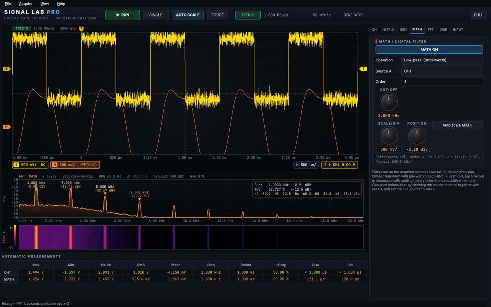
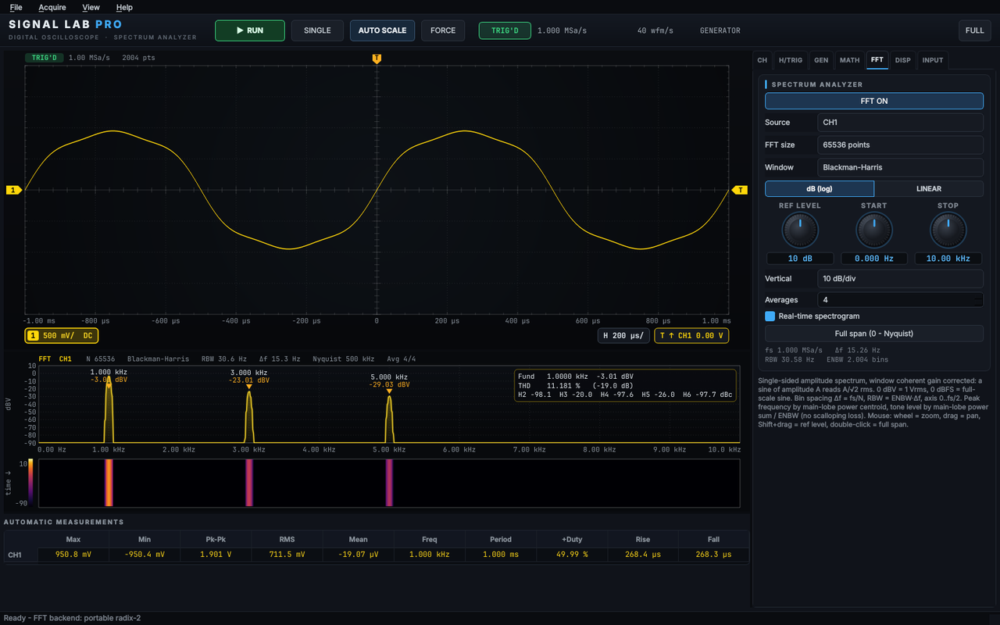
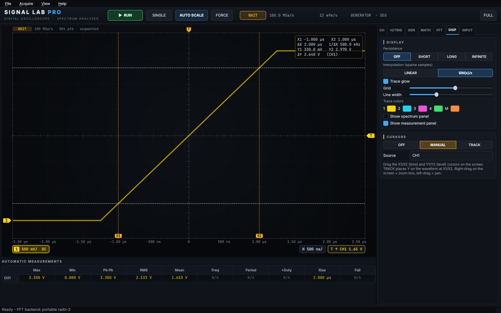
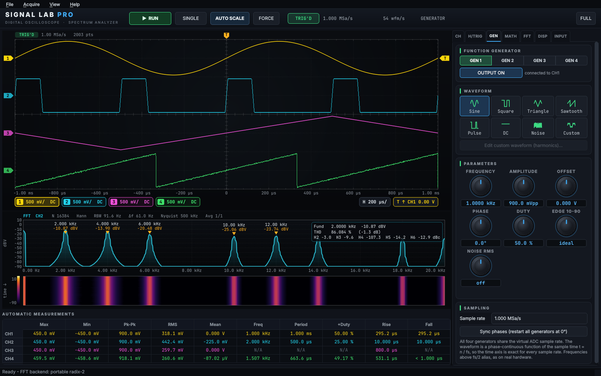
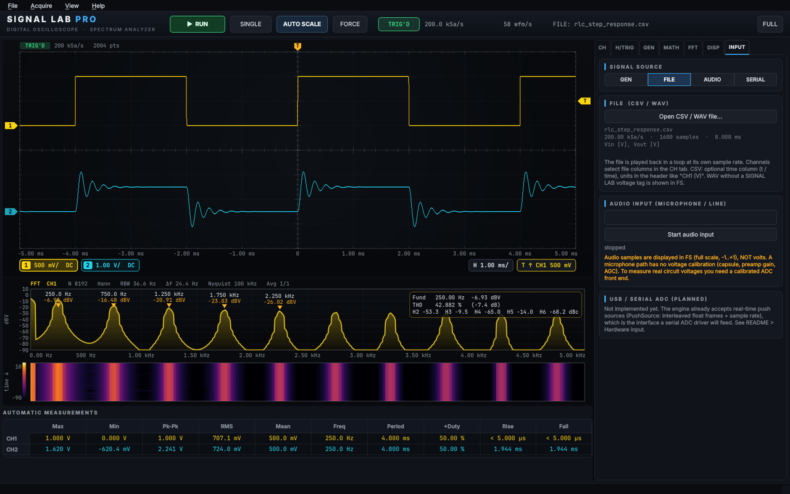

# SIGNAL LAB PRO

**C++20 / Qt 6 기반 macOS용 디지털 오실로스코프 · 스펙트럼 분석기**

하드웨어 없이도 실험할 수 있는 4채널 가상 오실로스코프입니다. 내장 함수 발생기, 실제 샘플 데이터에서
판정하는 트리거, IEEE 181 방식 자동 측정, FFT 스펙트럼 분석기와 스펙트로그램, 디지털 필터, CSV/WAV
입출력을 갖췄으며, 마이크/라인 입력으로 실제 오디오 신호도 분석할 수 있습니다.



| FFT · 고조파 · THD | 커서로 상승시간 측정 |
|---|---|
|  |  |
| **4채널 + 함수 발생기 패널** | **CSV 파일 재생 (RLC 계단 응답)** |
|  |  |

---

## 목차
1. [구현 현황](#1-구현-현황)
2. [빌드 및 실행 (macOS)](#2-빌드-및-실행-macos)
3. [검증 환경과 주의사항](#3-검증-환경과-주의사항)
4. [사용법](#4-사용법)
5. [내부 구조](#5-내부-구조)
6. [신호 처리 정의 (측정 · 트리거 · FFT · 필터)](#6-신호-처리-정의)
7. [입력 소스와 전압 표시 정책](#7-입력-소스와-전압-표시-정책)
8. [데이터 포맷](#8-데이터-포맷)
9. [가상 신호 실험 예제](#9-가상-신호-실험-예제)
10. [자동 테스트](#10-자동-테스트)
11. [성능](#11-성능)
12. [하드웨어 입력 확장 계획](#12-하드웨어-입력-확장-계획)

---

## 1. 구현 현황

### 구현됨 (빌드 및 자동 테스트로 검증)

| 영역 | 내용 |
|---|---|
| 채널 (CH1~CH4) | 켜기/끄기, 채널 색상(CH1 노랑 · CH2 시안 · CH3 자홍 · CH4 녹색, 변경 가능), V/div(1-2-5 단계, Shift = 미세 조정), 수직 위치, DC/AC/GND 커플링, 반전, 입력 라우팅, 선 굵기 |
| 수평축 | s/div(10 ns ~ 50 s), 지연(수평 오프셋), 트리거 위치(0~100 %), 롤 모드(AUTO 트리거에서 50 ms/div 이상), 마우스 확대/축소/이동 |
| 함수 발생기 4개 | Sine, Square, Triangle, Sawtooth, Pulse, DC, White Noise(가우시안), Custom(고조파/부분음 합성, 프리셋: 구형파·톱니파 근사, 2-톤, AM). 주파수, 진폭(Vpp), DC 오프셋, 위상, 듀티, 10-90 % 에지 시간, 가산 노이즈(rms), 샘플링 주파수(1 kSa/s ~ 100 MSa/s) 실시간 조절. 위상 연속(DDS 방식), 위상 동기화 |
| 트리거 | Auto / Normal / Single, 상승/하강 에지, 레벨, 소스, 홀드오프, 히스테리시스(노이즈 제거), 트리거 위치, 사전 트리거 데이터(링 버퍼), 샘플 간 보간으로 지터 없는 정렬, Force, Single 후 정지 |
| 자동 측정 | Max, Min, Pk-Pk, RMS, Mean, Frequency, Period, +Duty, Rise, Fall (+ Top, Base, Amplitude, AC RMS). 데이터 부족 시 N/A, 샘플 간격보다 빠른 에지는 "< 값" 상한 표시 |
| 커서 | X1/X2(시간), Y1/Y2(레벨) 수동 모드, 파형 추적(Track) 모드, ΔX · 1/ΔX · ΔY · ΔY/ΔX 표시, 마우스 드래그 |
| FFT · 스펙트럼 | 1k~256k 포인트, Rectangular/Hann/Hamming/Blackman-Harris/Flat Top, dB(dBV/dBFS)·선형, 지수 평균, 피크 탐지(서브빈 정밀도), 기본파·고조파·THD, 확대/이동, 실시간 스펙트로그램 |
| 디지털 필터 · 연산 (MATH) | Butterworth LPF/HPF/BPF(1~8차), 이동평균, A+B, A−B, A×B, 미분, 적분. 필터 전후 비교(소스 채널과 MATH 동시 표시, FFT 소스를 MATH로) |
| 입력 | 내장 발생기, CSV/WAV 파일(루프 재생), 마이크/라인 입력(Qt Multimedia, FS 단위 표시) |
| 저장 | CSV 파형, WAV(16-bit PCM / 32-bit float, 전압 태그로 무손실 왕복), PNG 화면 이미지(Retina 해상도), 측정 결과 CSV, 설정(JSON) 저장/불러오기, 세션 자동 저장·복원 |
| GUI | 다크 계측기 테마, 회전 노브(휠·드래그·더블클릭 직접 입력·우클릭 초기화), 세그먼트 버튼, 트리거 상태 표시, 측정 패널, 지속(phosphor persistence), 글로우, sin(x)/x 보간, 전체화면, Retina 지원 |
| 구조 | 수집 엔진 전용 스레드, GUI와 분리된 순수 C++ 코어, 링 버퍼(채널당 4 Mpt), 샘플링/생성/화면 갱신 속도 독립 관리, Apple Accelerate(vDSP) FFT |

### 부분 구현 / 제약

| 항목 | 상태 |
|---|---|
| 마이크 입력 | 코드 구현 완료(장치 선택, Float/Int16/Int32/UInt8 변환, Qt 6.5+ 마이크 권한 요청). **이 저장소의 개발 환경에는 오디오 장치가 없어 실제 캡처는 실행 검증하지 못했습니다.** 엔진 쪽 경로(PushSource)는 자동 테스트로 검증했습니다. |
| WAV 저장 | 화면 레코드(실효 샘플링 주파수)를 저장합니다. 실효 샘플링 주파수가 정수 Hz가 아니면 거부합니다(CSV 사용). 일반 오디오 플레이어는 384 kHz 초과 파일을 재생하지 못할 수 있습니다. |
| Normal/Single 모드의 느린 스윕 | 트리거 이후 데이터가 모두 모일 때까지 기다린 뒤 한 번에 표시합니다(점진적 그리기는 미구현). AUTO 모드의 느린 스윕은 롤 모드로 동작합니다. |
| 시간축 데시메이션 | 화면에 1 Mpt를 넘는 경우 점 샘플링(가상 소스) 또는 박스카 평균(실시간 입력)으로 자동 데시메이션합니다. 별도의 Peak-Detect 수집 모드는 없습니다(표시는 픽셀 단위 min/max 엔벨로프). |

### 미구현

- **USB / 시리얼 ADC 입력**: UI에 자리만 있으며 기능은 없습니다. 엔진은 이미 실시간 Push 소스 인터페이스를 갖추고 있습니다([12장](#12-하드웨어-입력-확장-계획)).
- 마이크/ADC 전압 교정(calibration) 기능
- 에지 이외의 트리거(펄스폭, 런트, 비디오, 시리얼 디코드 등), 파형 평균(acquisition averaging), XY 모드, 마스크 테스트
- 측정 통계(평균/표준편차/최소/최대 누적)
- 앱 아이콘 파일(.icns) — 실행 중 아이콘은 코드로 그립니다.

---

## 2. 빌드 및 실행 (macOS)

### 요구사항
- macOS 12 이상 권장 (Apple Silicon, Intel 모두)
- Xcode Command Line Tools: `xcode-select --install`
- [Homebrew](https://brew.sh)
- Qt 6.2 이상 (Qt 6.5 이상 권장 — 마이크 권한 API), CMake 3.21 이상, Ninja(선택)

```bash
brew install qt cmake ninja
```

### 빌드

```bash
git clone <this repository> SignalLabPro && cd SignalLabPro
```

```bash
cmake -S . -B build -G Ninja -DCMAKE_BUILD_TYPE=Release -DCMAKE_PREFIX_PATH="$(brew --prefix qt)"
```

```bash
cmake --build build
```

설정 단계에서 `SIGNAL LAB PRO: FFT backend = Apple Accelerate vDSP`가 출력되면 Accelerate가 사용됩니다.
(`-DSLP_USE_ACCELERATE=OFF`로 이식형 FFT를 강제할 수 있습니다.)

### 테스트

```bash
ctest --test-dir build --output-on-failure
```

GUI 테스트와 재시작 테스트는 `QT_QPA_PLATFORM=offscreen`으로 실행됩니다. 사용 중인 Qt 설치에 offscreen
플랫폼 플러그인이 없어 실패한다면 해당 두 테스트만 `QT_QPA_PLATFORM=cocoa`로 다시 실행하십시오.

### 실행

```bash
open build/SignalLabPro.app
```

처음 마이크 입력을 시작하면 macOS가 마이크 접근 권한을 묻습니다(Info.plist에 `NSMicrophoneUsageDescription` 포함).
터미널에서 바이너리를 직접 실행하면 권한이 터미널 앱에 귀속되므로 `.app`으로 실행하는 것을 권장합니다.

### 배포용 번들 (선택)

```bash
"$(brew --prefix qt)/bin/macdeployqt" build/SignalLabPro.app -dmg
```

### Apple Silicon / Intel
Homebrew Qt는 설치된 Mac의 아키텍처로만 빌드되므로 각 Mac에서 그대로 빌드하면 됩니다. Universal 바이너리가
필요하면 Universal Qt(Qt 온라인 설치 프로그램)를 설치하고 `-DCMAKE_OSX_ARCHITECTURES="arm64;x86_64"`를 지정합니다.

### 명령행 옵션

| 옵션 | 설명 |
|---|---|
| `--open <file>` | CSV/WAV 파일을 열고 자동 스케일 |
| `--load-setup <json>` | 설정 파일 적용 (예: `examples/setups/lowpass_filter.json`) |
| `--settings <json>` | 세션 파일 경로 (기본: 사용자 설정 폴더의 `session.json`) |
| `--size 1600x1000`, `--tab <n>` | 창 크기, 제어 패널 탭(0=CH … 6=INPUT) |
| `--quit-after <ms>`, `--screenshot <png>`, `--dump-settings <json>` | 자동 종료/스크린샷/설정 덤프 (테스트·문서용) |

### Linux에서 빌드 (개발 검증 환경)
Ubuntu 24.04 기준: `sudo apt install qt6-base-dev qt6-multimedia-dev libgl-dev cmake ninja-build g++`.
이후 빌드 명령은 동일합니다(`CMAKE_PREFIX_PATH` 불필요).

---

## 3. 검증 환경과 주의사항

정확하게 구분해 둡니다.

- **실제로 빌드 · 실행 · 테스트한 환경**: Ubuntu 24.04, Qt 6.4.2, GCC 13.3 및 Clang(경고 0개), 37개 ctest 전부 통과.
  GUI는 offscreen 플랫폼으로 실행해 스크린샷(이 문서의 이미지)과 상호작용 테스트로 확인했습니다.
- **macOS에서는 이 작업 환경에 Mac이 없어 빌드를 실행해 보지 못했습니다.** 코드는 macOS를 대상으로 작성했고
  플랫폼 의존 부분은 다음뿐입니다. macOS에서 처음 빌드할 때 문제가 있으면 알려주세요.
  - `Dsp.cpp` / `Measurements.cpp`의 Accelerate(vDSP) 호출: `vDSP_create_fftsetup`, `vDSP_ctoz`, `vDSP_fft_zrip`,
    `vDSP_vmul`, `vDSP_maxv`, `vDSP_minv`. 테스트 `fft_matches_naive_dft`가 vDSP 결과를 직접 DFT와 비교하므로,
    macOS에서 `ctest`를 실행하면 이 경로가 검증됩니다.
  - `MainWindow.cpp`의 Qt 6.5+ 마이크 권한 코드(`QMicrophonePermission`)는 Qt 6.4 환경에서는 컴파일되지 않는
    경로라 macOS(Homebrew Qt 6.5+)에서 처음 컴파일됩니다.
  - `cmake/Info.plist.in` (마이크 권한 문구, Retina 플래그)
- 마이크 캡처는 장치가 없어 실행 검증하지 못했습니다(엔진 경로는 테스트됨).

---

## 4. 사용법

### 화면 구성
- **상단 바**: RUN/STOP(초록 = 수집 중, 빨강 = 정지), SINGLE, AUTO SCALE, FORCE, 트리거 상태
  (`TRIG'D` 트리거됨 · `AUTO` 트리거 없이 자유 실행 · `WAIT` 트리거 대기 · `ARMED` 싱글 대기 · `ROLL` · `STOP`),
  실효 샘플링 주파수, 초당 파형 수, 입력 소스(`SEG` = 세그먼트 수집 중)
- **스코프 화면**: 10 × 8 눈금. 왼쪽 마커 = 각 채널의 0 V 위치, 오른쪽 `T` = 트리거 레벨, 위쪽 `T` = 트리거 시점.
  아래 배지 = 채널별 V/div · 커플링(클릭하면 선택), 수평축 · 트리거 요약
- **스펙트럼 패널**: FFT(위)와 스펙트로그램(아래, 최신이 위). 피크 표시와 기본파/THD/고조파 표
- **측정 패널**: 채널별 10개 자동 측정 (셀에 마우스를 올리면 Top/Base/Amplitude/AC RMS 등 추가 정보)
- **제어 패널 탭**: CH, H/TRIG, GEN, MATH, FFT, DISP, INPUT

### 키보드
| 키 | 동작 |
|---|---|
| Space | Run / Stop |
| S | Single |
| A | Auto Scale |
| F | Force Trigger |
| ⌃⌘F / F11 | 전체화면 |
| ⌘1 / ⌘2 / ⌘3 | 제어 패널 / 스펙트럼 / 측정 패널 표시 전환 |
| ⌘O, ⌘E, ⌘P, ⇧⌘E | 파일 열기, CSV 저장, 이미지 저장, 측정 내보내기 |
| ⌘S, ⌘L | 설정 저장 / 불러오기 |

### 마우스
| 위치 | 동작 |
|---|---|
| 스코프: 휠 | time/div |
| 스코프: Shift + 휠 | 선택된 채널의 V/div |
| 스코프: Alt(⌥) + 휠 | 선택된 채널의 위치 |
| 스코프: 왼쪽 드래그 | 시간축 이동(지연) |
| 스코프: 오른쪽 드래그 | 확대 영역 지정(시간 + 선택 채널 전압) |
| 왼쪽 여백 마커 드래그 | 채널 위치 |
| 오른쪽 여백 `T` 드래그 | 트리거 레벨 |
| 위쪽 여백 드래그 | 트리거 위치(%) |
| 커서 선 드래그 | X1/X2/Y1/Y2 이동 |
| 스펙트럼: 휠 / 드래그 / Shift+드래그 / 더블클릭 | 주파수 확대 / 이동 / 기준 레벨 / 전체 범위 |
| 노브 | 휠·드래그(Shift = 미세), 더블클릭 = 값 입력(`1.5k`, `200m`, `10u`, `2 MHz`), 우클릭 = 기본값 |

정지(STOP) 상태에서도 time/div, 지연, V/div를 바꾸면 **수집 메모리(링 버퍼)에 남은 데이터에서 레코드를 다시
추출**하므로, 실제 DSO처럼 정지된 파형을 확대/이동할 수 있습니다.

---

## 5. 내부 구조

```
 GUI 스레드 (Qt)                                   수집 엔진 스레드 (순수 C++20)
 ┌──────────────────────────┐   ScopeSettings    ┌──────────────────────────────────────────────┐
 │ MainWindow (GUI 컨트롤러)│ ─────────────────▶ │ SampleSource: SignalGenerator×4 / File / Push │
 │  ├ ScopeView  (렌더러)   │   명령(Run/Stop…)  │      │ 채널 처리: AC 커플링·GND·반전          │
 │  ├ SpectrumView          │                    │      ▼                                       │
 │  ├ 측정 테이블           │ ◀───────────────── │ SampleRing ×4 (4 Mpt, 절대 인덱스)            │
 │  └ AudioInput ──┐        │  Frame / Spectrum  │      │ EdgeTrigger (실제 샘플, 보간)          │
 └─────────────────┼────────┘  (shared_ptr)      │      ▼                                       │
                   │ SPSC 링 버퍼 (lock-free)     │ Frame 추출 → MATH/필터 → Measurements         │
                   └────────────────────────────▶│ SpectrumAnalyzer(vDSP) → 피크/고조파          │
                                                  └──────────────────────────────────────────────┘
```

| 모듈 | 파일 | 역할 |
|---|---|---|
| Signal Generator | `src/core/SignalGenerator.*` | 위상 누산기(DDS) 함수 발생기, 가우시안 노이즈(xoshiro256** + Box-Muller) |
| Acquisition Engine | `src/core/Acquisition.*` | 스레드, 소스 관리, 링 버퍼, 데시메이션, 세그먼트 수집, 프레임/스펙트럼 생성, 자동 스케일 |
| Trigger Engine | `src/core/Trigger.*` | 에지 트리거(히스테리시스, 홀드오프, 서브샘플 보간) |
| DSP / FFT Engine | `src/core/Dsp.*` | vDSP/이식형 FFT, 창 함수, 스펙트럼 정규화, 피크·고조파, Butterworth, 이동평균, MATH |
| Measurement Engine | `src/core/Measurements.*` | 자동 측정 |
| Ring buffers | `src/core/RingBuffer.h` | `SampleRing`(수집 메모리), `SpscRing`(실시간 입력용 lock-free FIFO) |
| Data Import/Export | `src/core/FileIO.*`, `src/app/SettingsJson.*` | CSV/WAV, 설정 JSON |
| Waveform Renderer | `src/app/ScopeView.*`, `src/app/SpectrumView.*` | 파형/스펙트럼/스펙트로그램 렌더링, 마우스 조작 |
| GUI Controller | `src/app/MainWindow.*`, `src/app/Controls.*` | 패널, 메뉴, 노브/테마 |

### 세 가지 속도의 독립 관리
1. **샘플링 속도**: 발생기의 가상 ADC 속도 또는 파일/장치 속도. 화면이 1 Mpt를 넘으면 자동 데시메이션(실효 속도 표시).
2. **신호 생성 속도**: 가상 소스는 벽시계에 맞춰 실시간 스트리밍합니다. 채널당 4 MSa/s 예산을 넘으면(예: 100 MSa/s)
   실제 DSO처럼 **연속 세그먼트 + 데드 타임** 방식으로 수집합니다. 발생기는 샘플 시각 `t = n / fs`의 위상 연속 함수이므로
   세그먼트 사이를 건너뛰어도 시간축이 정확히 유지됩니다.
3. **화면 갱신 속도**: 엔진은 설정한 프레임 속도(15/30/60/120 fps) 이하로 프레임을 만들고, GUI는 16 ms 타이머로 최신 프레임만 가져옵니다.

---

## 6. 신호 처리 정의

### 자동 측정 (화면에 보이는 레코드 기준)
| 측정 | 정의 |
|---|---|
| Max / Min / Pk-Pk | 샘플 최댓값 / 최솟값 / 차이 |
| Top / Base | 히스토그램 방식(IEEE 181). 샘플의 60 % 이상이 두 최빈값 ±10 % 범위에 있으면 2레벨 신호로 보고, 최빈값 ±2 % 범위 샘플의 **중앙값**을 사용. 아니면 Max/Min |
| Amplitude | Top − Base |
| 기준 레벨 | Mid = (Top+Base)/2, 교차 히스테리시스 = max(5 % × Amplitude, 3σ<sub>noise</sub>) (최대 25 %). σ<sub>noise</sub>는 1차 차분의 MAD로 추정 |
| Period | 연속한 상승 Mid 교차(샘플 간 선형 보간) 간격의 평균. 교차가 2개 미만이면 N/A, 개별 주기의 변동계수가 25 %를 넘으면(노이즈) N/A |
| Frequency | 1 / Period |
| +Duty | 양(+) 펄스폭(상승→다음 하강 교차) 평균 / Period × 100 % |
| Rise / Fall | Base→Top의 10 %→90 %(90 %→10 %) 시간, 화면 안의 모든 완전한 에지 평균. 대부분의 에지가 한 샘플 간격 안에서 끝나면 `< Δt`로 표시 |
| Mean / RMS | 주기를 알면 **정수 주기 구간**에서 계산(부분 주기 오차 제거), 아니면 전체. RMS는 DC 포함 실효값, AC RMS = 표준편차 |
| 단위 | 채널 단위(V 또는 FS), Hz, s, % |

### 트리거
- 상승: 신호가 (레벨 − 히스테리시스) 아래로 내려가면 Arm, 이후 처음 레벨 이상이 되는 샘플에서 발생. 하강은 대칭.
- 히스테리시스 = 0.08 div(일반) 또는 0.5 div(Noise reject) × 소스 채널 V/div.
- 트리거 시점은 레벨을 사이에 둔 두 샘플을 선형 보간한 **소수점 샘플 인덱스**로 저장하고, 화면은 그 시점을 정확히 t = 0에 배치합니다.
- 프레임 범위 = [−트리거위치 × W + 지연, +W]. 사전 트리거 데이터는 링 버퍼에서 가져오며, 사후 데이터가 다 모인 가장 최근 트리거를 사용합니다.
- AUTO: max(150 ms, 2 × 화면 시간) 동안 트리거가 없으면 최신 데이터로 자유 실행. NORMAL: 트리거 때만 갱신. SINGLE: 첫 트리거 레코드 후 정지.

### FFT
- 백엔드: macOS는 `vDSP_fft_zrip`(Accelerate), 그 외 이식형 radix-2 실수 FFT. 둘 다 정규화하지 않은 DFT `X[k] = Σ x[n]·e^(−j2πkn/N)`.
- 창 함수: 주기형(periodic) Hann/Hamming/Blackman-Harris/Flat Top/Rectangular.
- 정규화: `A[k] = 2|X[k]| / Σw` (DC·Nyquist는 `|X|/Σw`) → 빈 중앙의 사인파(피크 진폭 A)가 정확히 A로 읽힘. 표시는 **실효값 전력** `P = A²/2`.
- dB 기준: **0 dBV = 1 Vrms**, **0 dBFS = 풀스케일 사인파**(피크 1 FS).
- 주파수축: `f[k] = k·fs/N`, k = 0 … N/2 (N/2 = Nyquist = fs/2). 빈 간격 Δf = fs/N, RBW = ENBW × Δf (Hann ENBW = 1.5 bin).
- 톤 레벨 = 메인로브 내 전력 합 / ENBW → 스캘럽 손실 없음(사각창 제외). 톤 주파수 = 메인로브 전력 무게중심(사각창은 포물선 보간). Hann/Hamming/Blackman-Harris/Flat Top에서 주파수 오차 0.01 bin 미만, 진폭 오차 0.05 dB 미만을 테스트로 검증(실측 최대 0.003 bin, 0.003 dB).
- 고조파: 가장 큰 피크를 기본파로 하고 2~10차를 탐색, `THD = √(ΣP_h, h≥2) / √P_1`.
- 평균: 지수 전력 평균(N회). 스펙트로그램은 각 스펙트럼을 컬러맵(inferno 계열)으로 한 줄씩 누적.

### 디지털 필터 / MATH
- Butterworth LPF/HPF: 쌍극점마다 Q = 1/(2·sin((2k+1)π/2N))인 2차 섹션 캐스케이드(홀수 차수는 1차 섹션 추가),
  **사전 왜곡(pre-warping)을 적용한 쌍선형 변환** → 차단 주파수에서 정확히 −3.01 dB. BPF = HPF(f₁) + LPF(f₂).
- 차단 주파수는 0.499 × fs로 제한하고, 제한된 경우 경고를 표시합니다.
- 상태 변수는 double 정밀도(낮은 fc/fs에서도 안정). 인과(causal) 필터이며, 매 레코드마다 링 버퍼의 이전 데이터를
  "안정화 구간(lead-in)"으로 먼저 통과시킨 뒤 화면 구간만 표시합니다(과도응답 제거).
- 이동평균: 인과 N점 박스카(첫 영점 fs/N). 미분: 중앙 차분(단위 V/s). 적분: 사다리꼴, 화면 시작점 = 0(단위 V·s).
- AC 커플링: 실제 오실로스코프 입력처럼 10 Hz 1차 고역통과(쌍선형), 시작 시 평균으로 초기화.

---

## 7. 입력 소스와 전압 표시 정책

| 소스 | 단위 | 비고 |
|---|---|---|
| 내장 발생기 | V | 발생기 출력을 프로브 끝 전압으로 간주 |
| CSV | 헤더의 단위(예: `CH1 (V)`), 없으면 V | 파일에 적힌 값을 그대로 표시 |
| WAV (SIGNAL LAB PRO가 저장) | 저장된 단위(V) | `SLP_VFS` 태그의 풀스케일 전압으로 복원 |
| WAV (일반) | **FS** | −1…+1 정규화 값. 전압이 아님 |
| 마이크/라인 입력 | **FS** | 교정 없이 전압으로 표시하지 않음 |

마이크 경로(캡슐, 프리앰프 이득, AGC, 오디오 ADC)는 전압 교정 정보가 없으므로 **FS(full scale)** 단위로만 표시하고,
스펙트럼은 dBFS로 표시합니다. 외부 회로의 실제 전압을 측정하려면 교정된 입력부를 가진 ADC 하드웨어가 필요합니다.

---

## 8. 데이터 포맷

- **CSV 내보내기**: `#` 주석(날짜, 소스, 트리거, `sample_rate_hz=`) + `time (s),CH1 (V),…`. 시간은 트리거 기준.
  측정 결과 CSV: `trace,measurement,value,unit,valid,upper_bound` + FFT 피크/THD.
- **CSV 불러오기**: 쉼표/세미콜론/탭 자동 판별, 소수점 쉼표(`;` 구분 시), 헤더 유무, 시간 열(`t`, `time`, `seconds` …,
  단위 ms/us/ns 지원) 자동 감지. 시간 간격이 1 % 이상 불균일하면 선형 보간으로 재샘플링. 값 열은 최대 4개.
- **WAV**: 읽기 PCM 8/16/24/32-bit, float 32/64, WAVE_FORMAT_EXTENSIBLE. 쓰기 16-bit PCM / 32-bit float, 3채널 이상은 EXTENSIBLE,
  `LIST/INFO/ICMT`에 `SLP_VFS=<풀스케일 전압>;SLP_UNITS=V,…` 기록.
- **설정(JSON)**: 모든 채널/발생기/트리거/수평축/MATH/FFT/디스플레이/커서 설정. 누락되거나 잘못된 키는 기본값/범위로 보정.
  종료 시와 변경 1초 후 자동으로 세션 저장, 다음 실행 시 복원.

---

## 9. 가상 신호 실험 예제

`File > Load Setup…`(⌘L) 또는 `--load-setup`으로 불러옵니다. 괄호 안은 이론값이며, 모두 이 문서의 스크린샷
환경에서 확인한 결과입니다.

| 설정 파일 | 실험 | 확인할 내용 |
|---|---|---|
| `examples/setups/am_modulation.json` | 10 kHz 반송파, 1 kHz 변조, m = 0.5 (부분음 합성으로 정확한 AM) | 트리거 레벨 1.2 V + 홀드오프 0.6 ms로 엔벨로프 고정. FFT: 9/10/11 kHz, 측파대 −12.04 dBc (20·log₁₀(m/2)) |
| `lowpass_filter.json` | 노이즈 섞인 1 kHz 구형파 + 4차 Butterworth LPF 3 kHz | 기본파 −0.91 dBV (4/π V 피크), 3 kHz 고조파 −13.46 dBV (−10.46 dB − 3.01 dB). FFT 소스를 CH1로 바꿔 전후 비교 |
| `square_rise_time.json` | 3.3 V, 10 kHz 펄스, 에지 2 µs, 100 MSa/s | Rise = 2.000 µs, 커서 ΔX = 2 µs. 화면에 한 주기가 없으므로 Freq/Period = N/A |
| `phase_shift.json` | 1 kHz 사인 두 개, CH2가 60° 지연 | 커서 ΔX = 166.7 µs. MATH(CH1−CH2) 진폭 = 2·sin(30°) = 1 V 피크 |
| `harmonics_thd.json` | 기본파 + 10 % 3차 + 5 % 5차 | THD = 11.18 %, H3 = −20.0 dBc, H5 = −26.0 dBc |
| `noisy_trigger.json` | 1 kHz 사인 + 0.2 Vrms 노이즈 | NORMAL + Noise reject로 안정된 트리거, 긴 잔상, FFT 16회 평균 |
| `aliasing_demo.json` | 10 kSa/s에서 9.2 kHz 사인 | 800 Hz로 보임(|9.2k − 10k|). CH2의 실제 800 Hz와 비교, FFT 피크 800 Hz |
| `four_channels.json` | 4채널 동시: 사인 · 25 % 구형파 · 삼각파 · 톱니파 | 채널별 측정. 25 % 듀티 구형파는 4차 고조파가 사라짐 |

샘플 데이터 (`File > Open` 또는 `--open`):
- `examples/data/rlc_step_response.csv` — 직렬 RLC 저역통과(f₀ = 5 kHz, ζ = 0.15)의 250 Hz 구형파 응답, 200 kSa/s.
  오버슈트 62 % (e^(−πζ/√(1−ζ²)) = 62.1 %), 감쇠 진동 4.94 kHz.
- `examples/data/two_tone_440_660Hz.wav` — 48 kHz 스테레오. L = 440 Hz + 660 Hz, R = 대역제한 1 kHz 구형파(FS 단위).

---

## 10. 자동 테스트

`ctest`로 37개 항목을 실행합니다(코어 32 · 설정 3 · GUI 상호작용 1(9개 케이스) · 앱 재시작 1).

| 요구사항 | 테스트 |
|---|---|
| 발생기 주파수·진폭 | `generator_sine_frequency_amplitude`, `generator_square_duty_levels`, `generator_pulse_edge_time`, `generator_triangle_sawtooth_rms`, `generator_dc_and_noise`, `generator_custom_composite`, `generator_phase_and_continuity` |
| RMS · Vpp 계산, N/A 규칙 | 위 테스트들 + `measurement_na_rules` |
| FFT 피크 정확도 | `fft_matches_naive_dft`(vDSP/이식형 vs 직접 DFT), `fft_peak_accuracy_and_normalisation`(4개 창 × 3개 주파수: 주파수 오차 < 0.01 bin, 진폭 오차 < 0.02 dB(Hamming 0.05 dB), DC/축/Nyquist), `fft_harmonics_thd` |
| 트리거 검출 | `trigger_edge_detection_interpolated`(해석해 대비 0.01 샘플), `trigger_hysteresis_and_holdoff`, `engine_triggered_frame_alignment`, `engine_trigger_modes`(Auto/Normal/Single/Force, 정지 후 재추출), `engine_delay_offset` |
| 필터 응답 | `filter_frequency_response`(1~8차 LPF/HPF fc에서 −3.01 dB, 1디케이드 감쇠, BPF), `filter_time_domain`, `math_arithmetic_derivative_integral` |
| 샘플링 주파수 변경 | `engine_sample_rate_change`, `engine_decimation_and_roll`, `engine_segmented_high_rate`(100 MSa/s) |
| 여러 채널 동시 처리 | `engine_multichannel`, `engine_math_and_spectrum` |
| 입력 소스 | `engine_file_source`, `engine_push_source`, `engine_ac_coupling`, `engine_autoscale` |
| 파일 입출력 | `file_csv_roundtrip`, `file_wav_roundtrip` |
| 재시작 및 설정 복원 | `settings_*` 3개 + `app_restart_restores_settings`(실제 앱을 두 번 실행해 17개 키 비교) |
| GUI 상호작용 | `gui_interaction`: 휠 줌, V/div, 트리거 레벨/채널 위치 드래그, 이동, 확대 박스, 커서, 노브, 스펙트럼 확대 |

엔진 테스트는 실제 스레드 대신 시뮬레이션 시계(`tick(t)`)로 결정론적으로 실행됩니다.

---

## 11. 성능

- 렌더링: 화면 열(device pixel)마다 파형의 min/max를 구해 **안티앨리어싱된 수직 스팬으로 이미지 버퍼에 직접 래스터화**하고,
  배경/눈금은 캐시합니다. 노이즈 양과 무관한 비용으로 그려집니다.
  측정(Linux 컨테이너, 소프트웨어 래스터, 1600×800 위젯, Retina 2× 해상도, 노이즈 섞인 구형파):

  | 샘플 수 | 최적화 전 (굵은 안티앨리어싱 폴리라인) | 최적화 후 (스팬 래스터 + 배경 캐시) |
  |---|---|---|
  | 2,000 | 567 ms | 12.6 ms |
  | 100,000 | 3,343 ms | 12.1 ms |
  | 1,000,000 | 4,461 ms | 10.4 ms |

  (프레임 전체 렌더링 시간. Apple Silicon의 실제 화면에서는 이보다 빠를 것으로 예상하지만 측정하지는 못했습니다.)

- 수집: 프레임 생성 ~55 wfm/s(60 fps 제한), 1 Mpt × 4채널 레코드까지 처리. 링 버퍼 채널당 4 Mpt(64 MB).
- FFT는 화면 갱신과 별도로 최대 30회/s, 65536 포인트에서도 실시간.

---

## 12. 하드웨어 입력 확장 계획

엔진은 실시간 입력을 `PushSource`(lock-free SPSC 링 버퍼)로 받습니다. 마이크 입력이 이 경로를 사용하며, USB/시리얼
ADC 드라이버도 같은 인터페이스에 연결하면 트리거·측정·FFT·저장이 모두 그대로 동작합니다.

```cpp
auto src = std::make_shared<slp::PushSource>();
src->configure(/*sampleRate*/ 500e3, /*channels*/ 2);   // 장치 설정이 바뀔 때마다 호출
src->push(interleavedFloats, frames);                    // 수신 스레드에서 호출 (단위: 교정된 V)
engine.setPushSource(src);                               // 소스 종류 Serial로 연결 (구현 예정)
```

구현 시 필요한 항목: 시리얼 포트 선택(Qt SerialPort), 프레이밍(동기 바이트 + 채널 수 + 샘플 + CRC 권장),
ADC 코드 → 전압 교정(이득/오프셋, 프로브 감쇠), 샘플링 주파수 보고, 버퍼 오버런 감지(`PushSource::dropped()`).
실제 회로 전압 측정에는 입력 보호와 감쇠기, 교정된 기준 전압을 갖춘 ADC 하드웨어가 필요합니다.
